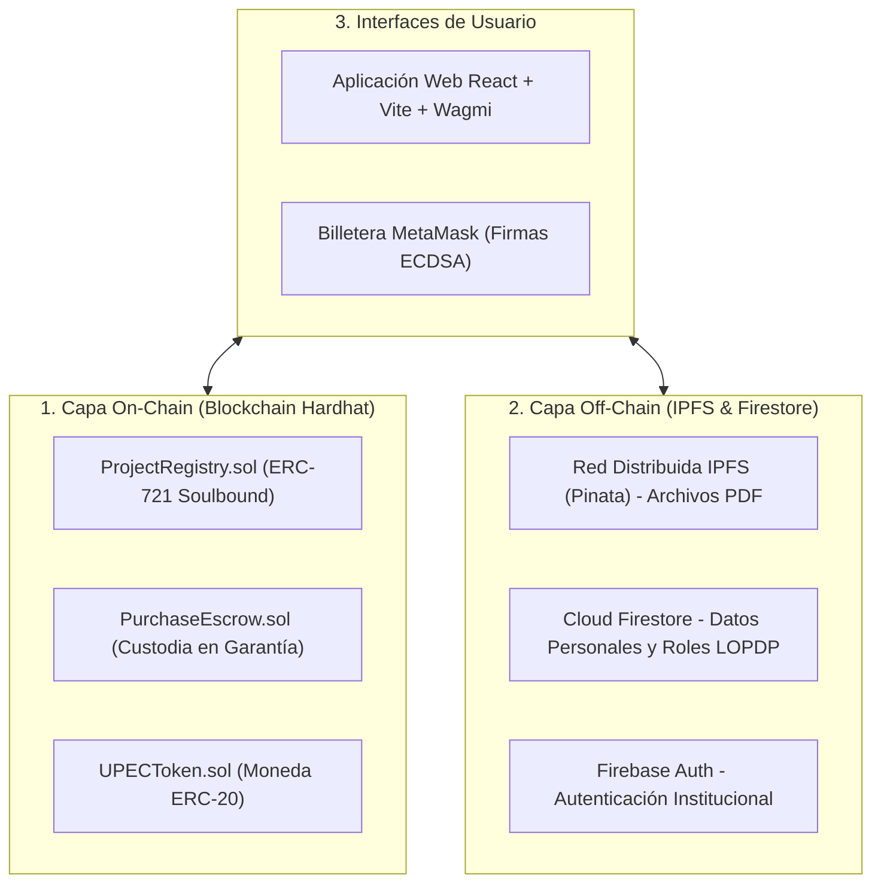
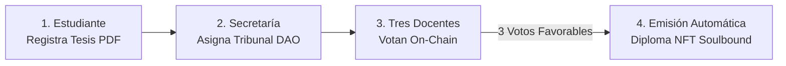
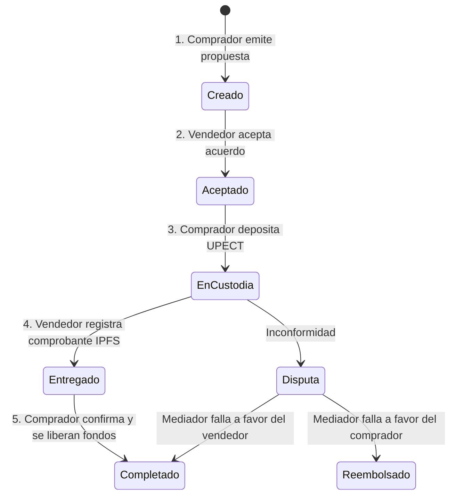

# Manual de Usuario: Sistema Web3 de Titulación y Custodia Descentralizada (UPEC)

**Universidad Politécnica Estatal del Carchi**  
*Facultad de Industrias Agropecuarias y Ciencias Ambientales (FIACA)*  
*Carrera de Computación*  
**Trabajo de Integración Curricular:** *"Arquitecturas descentralizadas con Web3 y Smart Contracts para la validación, trazabilidad y transferencia de datos digitales en la UPEC"*

---

## 1. Introducción y Arquitectura del Sistema

El prototipo académico de la UPEC implementa un ecosistema integral que combina la tecnología de contratos inteligentes en Ethereum con almacenamiento descentralizado (IPFS) y una capa de base de datos protegida (Google Cloud Firestore):

---

## 2. Puesta en Marcha Rápida (1 Clic)

El sistema cuenta con un ejecutable automático para Windows que levanta todos los microservicios sincronizados:

### Opción A (Recomendada):
Haz doble clic sobre el archivo:
📁 **`iniciar_todo.bat`**

Este script ejecuta en segundo plano:
1. El nodo Blockchain local de Hardhat (puerto `8545`).
2. El despliegue de los contratos inteligentes y la carga de datos semilla.
3. El proxy de subida a IPFS (puerto `8787`).
4. El servidor de frontend React/Vite (puerto `3000`).
5. Abre automáticamente tu navegador en `http://localhost:3000`.

---

## 3. Guía de Cuentas, Roles y Credenciales

Para el entorno experimental de la UPEC se han precargado 5 cuentas institucionales con sus respectivas billeteras y saldos de prueba en Hardhat:

| Rol Institucional | Nombre Completo | Correo Institucional | Dirección de Billetera (Pública) | Clave Privada (Para importar en MetaMask) |
| :--- | :--- | :--- | :--- | :--- |
| **Secretaría General (Admin)** | MSc. Gabriela Torres Benavides | `secretaria.demo@upec.edu.ec` | `0xf39Fd6e51aad88F6F4ce6aB8827279cffFb92266` | `0xac0974bec39a17e36ba4a6b4d238ff944bacb478cbed5efcae784d7bf4f2ff80` |
| **Docente 1 (Tribunal)** | PhD. Roberto Salazar Mena | `docente1.demo@upec.edu.ec` | `0x3C44CdDdB6a900fa2b585dd299e03d12FA4293BC` | `0x5de4111afa1a4b94908f83103eb1f1706367c2e68ca870fc3fb9a804cdab365a` |
| **Docente 2 (Tribunal)** | MSc. Patricia Guerrón Ortiz | `docente2.demo@upec.edu.ec` | `0x90F79bf6EB2c4f870365E785982E1f101E93b906` | `0x7c852118294e51e653712a81e05800f419141751be58f605c371e15141b077a6` |
| **Docente 3 (Tribunal)** | Ing. Javier Tapia Rosero | `docente3.demo@upec.edu.ec` | `0x15d34AAf54267DB7D7c367839AAf71A00a2C6A65` | `0x47e179ec197488593b187f80a00eb0da91f1b9d0b13f8733639f19c30a34926a` |
| **Estudiante (Graduando)** | Andrade Pérez Luis Fernando | `estudiante.demo@upec.edu.ec` | `0x70997970C51812dc3A010C7d01b50e0d17dc79C8` | `0x59c6995e998f97a5a0044966f0945389dc9e86dae88c7a8412f4603b6b78690d` |

* **Contraseña común de acceso para todas las cuentas en la aplicación:** `Upec-demo-2026`

---

## 4. Configuración de MetaMask para la Red Local

1. Abre la extensión de **MetaMask** en el navegador.
2. Ve al selector de redes superior > **Agregar red** > **Agregar una red manualmente**.
3. Ingresa los siguientes datos exactos:
   - **Nombre de la red:** `Hardhat Localhost`
   - **Nueva dirección URL de RPC:** `http://127.0.0.1:8545`
   - **Identificador de cadena (Chain ID):** `1337` *(o `31337`)*
   - **Símbolo de moneda:** `ETH`
4. Haz clic en **Guardar** y conéctate a esa red.

---

## 5. Manual Paso a Paso: Flujo de Titulación Web3

El proceso de titulación universitaria se ejecuta en 4 etapas sincronizadas:

### Paso 1: Registro de la Tesis por el Estudiante
1. Inicia sesión con: `estudiante.demo@upec.edu.ec` (Clave: `Upec-demo-2026`).
2. En MetaMask, selecciona la cuenta del estudiante (`0x7099...c79C8`).
3. En el menú de la izquierda, entra a **"Registrar tesis"**.
4. Llena los datos del proyecto: Título, Resumen, Carrera y sube el archivo PDF del manuscrito.
5. El sistema calcula en milisegundos el hash criptográfico SHA-256 del archivo y sube el documento a IPFS.
6. Haz clic en **"Registrar Tesis en la Blockchain"** y confirma en MetaMask.

### Paso 2: Asignación del Tribunal por Secretaría
1. Inicia sesión con: `secretaria.demo@upec.edu.ec`.
2. En MetaMask, conecta la cuenta de Secretaría (`0xf39F...2266`).
3. Ve al menú lateral > **"Tribunal DAO"**.
4. En la tarjeta de la tesis recién registrada (estado *Sin tribunal*), aparecerán 3 selectores desplegables:
   - **Docente 1:** PhD. Roberto Salazar Mena.
   - **Docente 2:** MSc. Patricia Guerrón Ortiz.
   - **Docente 3:** Ing. Javier Tapia Rosero.
5. Haz clic en **"Asignar Tribunal e Iniciar Votación"** y confirma la transacción en MetaMask.
6. A partir de este momento, el contrato inicia automáticamente el plazo reglamentario de 7 días.

### Paso 3: Evaluación y Votación Colegiada de los 3 Docentes
Cada integrante del tribunal calificador debe emitir su voto individual e inmutable:
1. Conecta en MetaMask la billetera de cada docente:
   - Para Docente 1: selecciona `0x3C44...`.
   - Para Docente 2: selecciona `0x90F7...`.
   - Para Docente 3: selecciona `0x15d3...`.
2. En la sección **Tribunal DAO**, haz clic en el botón verde **"Aprobar"** (o en el botón rojo **"Rechazar"**).
3. Confirma la transacción en MetaMask.
4. Repite el proceso con los 3 docentes.

### Paso 4: Emisión y Consulta del Certificado Oficial NFT
- Al registrarse el **tercer voto favorable**, el Smart Contract `ProjectRegistry.sol` alcanza automáticamente el **quórum unánime 3/3**.
- El contrato acuña y emite un **Token NFT ERC-721 Soulbound** intransferible a nombre del graduando.
- Ve al módulo **"Certificados NFT"** para admirar el Diploma Oficial UPEC con sus sellos, código QR y hashes criptográficos de los docentes.

---

## 6. Módulo del Título Oficial de Grado (Diploma UPEC)

Este módulo reproduce con fidelidad milimétrica el Título Oficial de Grado emitido por la Universidad Politécnica Estatal del Carchi:

### Elementos de Seguridad Institucional Incorporados
- **Marco de Portadiplomas:** Fondo de cuero azul marino oficial (`#0c192e`) con sus 4 esquinas blancas de sujeción tradicional.
- **Heráldica Oficial:** Escudo de Armas de la República del Ecuador en la parte superior central y Logotipo circular UPEC en la parte superior izquierda.
- **Franjas Institucionales:** Dos líneas verticales verdes continuas (`#006B38`) en el margen izquierdo.
- **Medallón Notarial Dorado:** Troquelado en 32 puntas con relieve UPEC y cinta tricolor ondulada.
- **Sellos Húmedos Oficiales:** Sellos circulares del Rectorado y de la Secretaría General con texto perimetral.
- **Marca de Agua Guilloché:** Patrón concéntrico de seguridad con el Búho UPEC centrado con opacidad sutil.

### Modos de Firma (Legalidad vs. Criptografía)
El sistema incluye un selector superior de 4 modos:
1. **Firmas y Sellos Oficiales:** Muestra las firmas de personas reales (Rector y Secretaría General) para cumplir el estándar físico de la LOES/SENESCYT.
2. **Firmas de Código Web3:** Reemplaza la tinta por los hashes criptográficos ECDSA `0x...` emitidos por las billeteras de los 3 docentes evaluadores.
3. **Líneas en Blanco:** Espacio para impresión en papel pergamino físico para ser firmado con pluma.
4. **Ocultar Firmas:** Modo limpio enfocado en el código QR y el hash inmutable de IPFS.

### Impresión y Exportación a PDF (300 DPI)
1. Presiona `Ctrl + P` (o haz clic en el botón superior **"Imprimir / Exportar PDF"**).
2. En la ventana del navegador elige:
   - **Destino:** Guardar como PDF.
   - **Diseño:** Vertical (Portrait).
   - **Márgenes:** Ninguno (None).
   - **Gráficos de fondo:** Activado (Checked).

---

## 7. Módulo de Contratos de Compraventa y Custodia (Purchase Escrow)

Gestiona acuerdos de adquisición de servicios académicos, licenciamiento de datasets de investigación o asesorías técnicas utilizando la moneda universitaria **UPECT (ERC-20)**:

### Ciclo Operativo:
1. **Emisión de la Propuesta:** El comprador entra a *Contratos de compraventa* > *Nueva Propuesta*, define el título, el precio en UPECT y la billetera del vendedor.
2. **Aceptación:** El vendedor conecta su billetera y presiona **"Aceptar Acuerdo"**.
3. **Depósito en Garantía:** El comprador presiona **"Depositar UPECT en Custodia"**. El Smart Contract bloquea los fondos de forma segura e imparcial.
4. **Registro de Entrega:** El vendedor suministra el enlace o CID de IPFS que certifica la entrega del servicio y presiona **"Confirmar Entrega"**.
5. **Liberación Definitiva:** El comprador valida la entrega y presiona **"Confirmar Recepción Conforme"**. Los tokens UPECT se transfieren automáticamente al vendedor.

---

## 8. Resolución de Problemas Frecuentes

### A. Error: `Nonce too high. Expected nonce to be X but got Y`
* **Causa:** Al reiniciar la red local de Hardhat, MetaMask conserva en su memoria caché las transacciones de sesiones anteriores.
* **Solución en 10 segundos:**
  1. En MetaMask, ve a **Configuración** ⚙️ > **Avanzado**.
  2. Haz clic en **"Borrar datos de actividad de la pestaña"** (o *"Restablecer cuenta"*).
  3. Confirma en **Borrar**. Esto no borra tus fondos ni tus llaves privadas.

### B. Error: `0xe450d38c` (`ERC20InsufficientBalance`)
* **Causa:** La billetera tiene ETH para gas, pero carece de tokens UPECT para el depósito de compraventa.
* **Solución:**
  1. Ve a la pestaña lateral **"Moneda UPECT"** (ERC-20).
  2. En el Dispensador Académico (Faucet), haz clic en **"Solicitar 100 UPECT"** y confirma en MetaMask.

### C. Error: `Missing or insufficient permissions`
* **Causa:** Reglas de Cloud Firestore pendientes de publicación en la consola de Firebase.
* **Solución:** Entra a la consola de Firebase > Firestore Database > pestaña **Reglas**, pega el código de `firestore.rules` y haz clic en **Publicar**.
